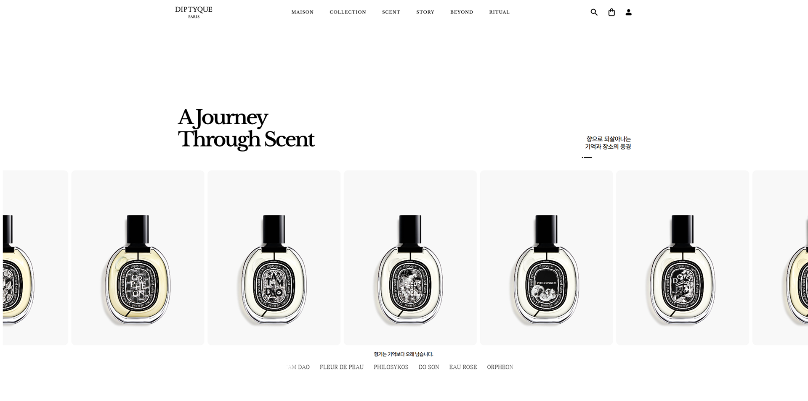
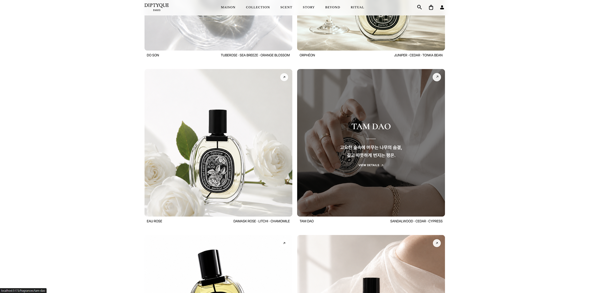
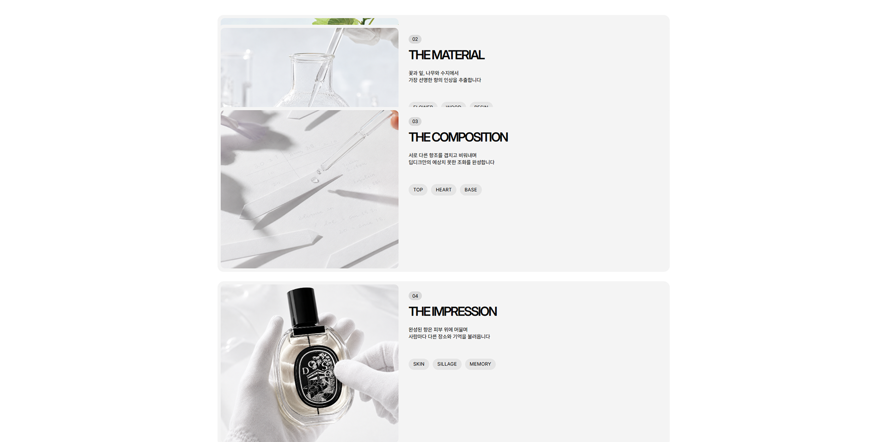
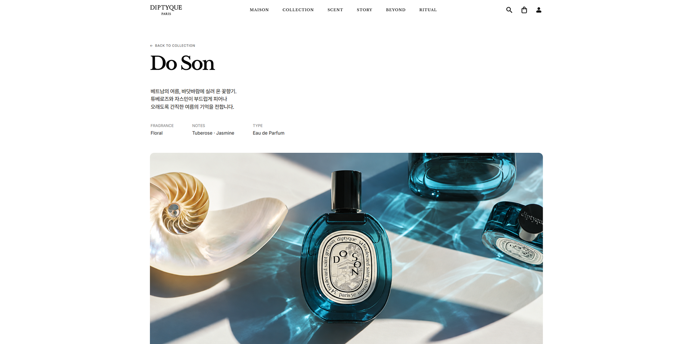

# DIPTYQUE Website Renewal

향수 브랜드의 감각적인 스토리텔링을 에디토리얼 레이아웃과 스크롤 인터랙션으로 재구성한 개인 웹사이트 리뉴얼 프로젝트입니다.

**Live Site:** [https://diptyque-portfolio.vercel.app/](https://diptyque-portfolio.vercel.app/)



> 본 프로젝트는 웹디자인·웹퍼블리싱 포트폴리오를 위한 개인 비상업적 리뉴얼 작업입니다. DIPTYQUE 공식 웹사이트가 아니며, 브랜드와의 제휴 또는 공식 제작 관계가 없습니다.

## Overview

| 항목          | 내용                               |
| ------------- | ---------------------------------- |
| 프로젝트명    | DIPTYQUE Website Renewal           |
| 프로젝트 유형 | 개인 웹사이트 리뉴얼 프로젝트      |
| 역할          | 웹디자인 및 프론트엔드 구현        |
| 구현 환경     | React 기반 Single Page Application |
| 배포          | Vercel                             |

DIPTYQUE의 브랜드 이미지와 향수별 서사를 웹에서 자연스럽게 탐색할 수 있도록 메인페이지와 6개의 향수 상세페이지를 구성했습니다. 시각적 흐름을 해치지 않는 인터랙션, 공통 컴포넌트와 데이터 기반의 상세페이지 구조, SPA 방식의 화면 전환에 중점을 두었습니다.

## Tech Stack

| 구분             | 기술                                                      |
| ---------------- | --------------------------------------------------------- |
| Design           | Figma                                                     |
| Frontend         | React 19, React DOM, JavaScript, CSS                      |
| Build Tool       | Vite 8                                                    |
| Routing          | React Router DOM 7                                        |
| Smooth Scroll    | Lenis                                                     |
| Interaction      | CSS Transition, Sticky Positioning, Intersection Observer |
| Code Quality     | ESLint                                                    |
| Media Management | Git LFS                                                   |
| Deployment       | Vercel                                                    |

## Key Features

- **Brand Storytelling**: 영상, 이미지, 타이포그래피를 조합해 향수 브랜드의 분위기와 이야기를 전달합니다.
- **Fragrance Collection**: 메인페이지 CON1의 향수 카드 6종을 각 상세페이지와 연결했습니다.
- **Collection Dropdown**: Header의 `COLLECTION` 메뉴에서 전체 너비의 반투명 드롭다운으로 향수를 탐색할 수 있습니다.
- **Search Overlay**: 영문·한글 향수명과 일부 키워드를 지원하는 클라이언트 사이드 검색 기능을 제공합니다.
- **Scroll Interaction**: Lenis와 CSS `sticky`, Intersection Observer를 활용해 카드 스태킹, 이미지 확대, 텍스트 리빌 등의 인터랙션을 구현했습니다.
- **Fragrance Detail Pages**: 공통 레이아웃과 향수별 데이터를 활용해 6개의 상세페이지를 구성했습니다.
- **SPA Routing**: React Router를 사용해 페이지 새로고침 없는 이동, 해시 섹션 이동, 뒤로 가기 시 스크롤 복원을 처리합니다.
- **Vercel Deployment**: 프로젝트를 Vercel 환경에 배포했습니다.

## Pages

### Main Page

| Section     | Description                                                   |
| ----------- | ------------------------------------------------------------- |
| Header      | 로고, 섹션 내비게이션, COLLECTION 드롭다운, 검색, 안내 토스트 |
| Main Visual | 향수 이미지를 활용한 무한 가로 마키                           |
| Hero Visual | 브랜드 메시지와 영상 비주얼                                   |
| About       | 브랜드 아이덴티티 소개                                        |
| CON1        | 향수 6종 컬렉션 및 상세페이지 연결                            |
| CON2        | 영상 중심의 브랜드 콘텐츠                                     |
| CON3        | Sticky 기반 카드 스태킹                                       |
| CON4        | 스크롤과 동기화되는 향수 선택 콘텐츠                          |
| CON5        | Hover 기반 카드 확장 인터랙션                                 |
| CON6        | FAQ 아코디언                                                  |
| CON7        | 이미지 확대 및 구분선 애니메이션                              |
| CON8        | Sticky 기반 텍스트 리빌                                       |
| Footer      | 브랜드 정보 및 BACK TO TOP 플로팅 기능                        |

### Fragrance Detail Pages

| Fragrance          | Route                          |
| ------------------ | ------------------------------ |
| ORPHÉON            | `/fragrances/orpheon`          |
| DO SON             | `/fragrances/do-son`           |
| EAU ROSE           | `/fragrances/eau-rose`         |
| TAM DAO            | `/fragrances/tam-dao`          |
| L’OMBRE DANS L’EAU | `/fragrances/lombre-dans-leau` |
| FLEUR DE PEAU      | `/fragrances/fleur-de-peau`    |

각 상세페이지는 `Hero`, `Story`, `Explore` 섹션으로 구성되며, 공통 컴포넌트에 향수별 이미지·영상·텍스트 데이터를 연결하는 방식으로 구현했습니다.

## Implementation Highlights

- `SiteLayout`에서 공통 Header와 Footer를 관리해 메인페이지와 상세페이지에서 동일한 내비게이션 경험을 제공합니다.
- 향수 정보를 데이터 파일로 분리하고 공통 상세 컴포넌트를 재사용해 중복 마크업을 줄였습니다.
- `RouteScrollManager`에서 일반 페이지 이동, 해시 이동, 브라우저 뒤로 가기·앞으로 가기의 스크롤 동작을 구분합니다.
- 검색 오버레이에 자동 포커스, 포커스 트랩, ESC 닫기, 배경 스크롤 잠금 기능을 적용했습니다.
- 주요 인터랙션에 키보드 접근과 `prefers-reduced-motion` 환경을 고려한 처리를 포함했습니다.
- 상세페이지 영상은 `autoplay`, `muted`, `loop`, `playsInline` 속성을 사용하며 대용량 MP4 리소스는 Git LFS로 관리합니다.

## Responsive Status

현재 레이아웃은 **데스크톱 환경을 중심으로 구현 및 검수**되어 있습니다. 1920px 디자인을 기준으로 1440px, 1366px, 1280px 데스크톱 화면의 콘텐츠 잘림을 보정했습니다.

태블릿 및 모바일 반응형은 최종 구현 전 단계이며, 이후 화면별 레이아웃과 터치 인터랙션을 추가로 정리할 예정입니다.

## Preview

프로젝트의 주요 화면과 인터랙션을 확인할 수 있는 스크린샷입니다.

### 메인페이지

README 상단의 대표 이미지는 브랜드의 시각적 분위기와 전체 콘텐츠 흐름을 담은 메인페이지입니다.

### 컬렉션

향수 6종을 탐색하고 각 상세페이지로 이동할 수 있는 컬렉션 영역입니다.



### 인터랙션

스크롤과 사용자 입력에 반응하도록 구성한 주요 인터랙션 화면입니다.



### 향수 상세페이지

향수별 이미지, 영상, 텍스트를 공통 레이아웃으로 구성한 상세페이지입니다.



## Getting Started

```bash
npm install
npm run dev
```

프로덕션 빌드와 코드 검사는 다음 명령어로 실행할 수 있습니다.

```bash
npm run lint
npm run build
```

## Notice

본 저장소는 개인 포트폴리오 목적으로 제작된 비상업적 프로젝트입니다. 프로젝트에 사용된 브랜드명과 관련 시각 자료의 권리는 각 원저작권자에게 있습니다.
